# 人体

# 动线
- 分为**律动线**（中线）和**三动线**
- 三动线的关键是保持一定的错位让身体产生动态感不僵硬
- 律动线是从头部中心到裆部大致接近颈椎的那条纵线，用于决定身体的走向
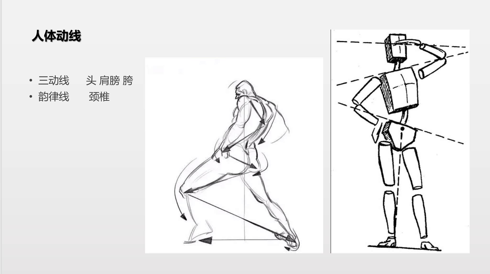

# 头部
- 肩宽约为 **1.25 个头宽**
- 注意透视：近镜头一侧肩膀略长，但需保持两侧肩宽基本等长
- 收细脖子时，参考"下巴到锁骨"的线条

# 锁骨与脖子
- 锁骨呈现类似类似衣架的造型，左右对称分布，中心处有凹陷
- 合理表达锁骨的曲线美是涩色的关键
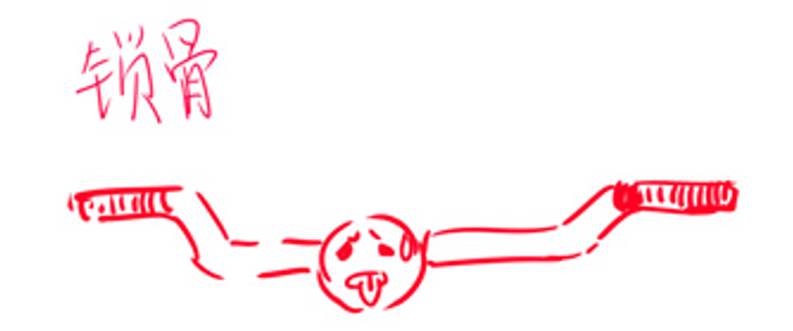
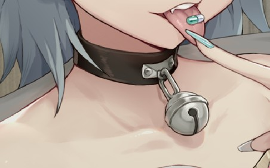

## 胸锁乳突肌
- 胸锁乳突肌以锁骨交汇处的凹陷点（胸骨上窝）为中心锚点连接
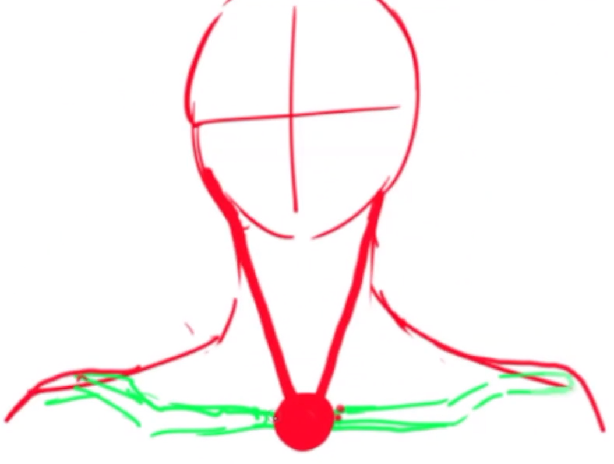

## 斜方肌
- 斜方肌形状类似垃圾铲，盖在锁骨上方，像有厚度的板块
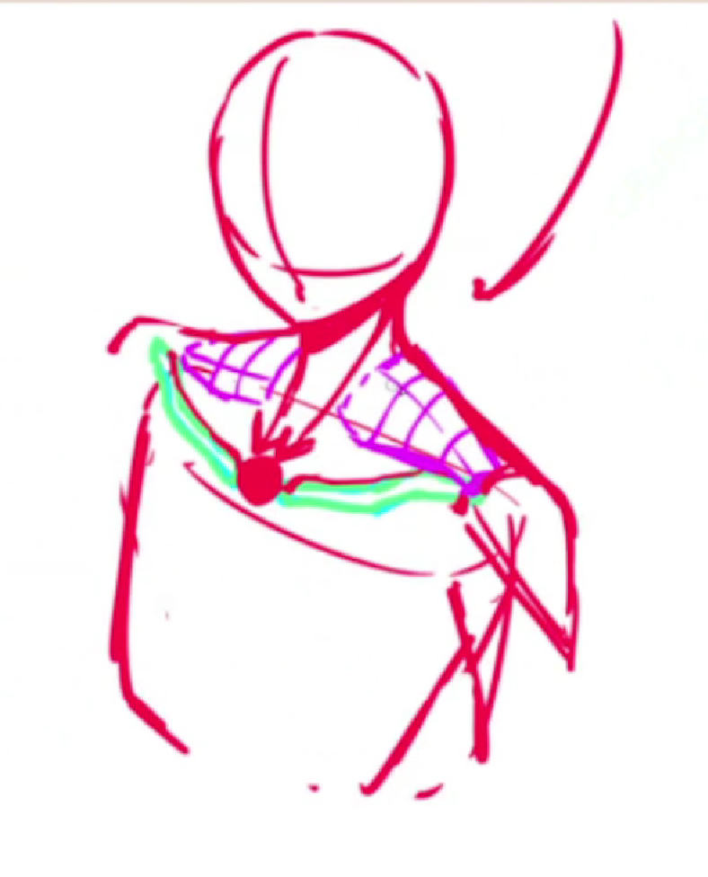

# 胸腔
- 胸腔应理解为类似椭圆圆柱体，而不是完全规则的圆柱
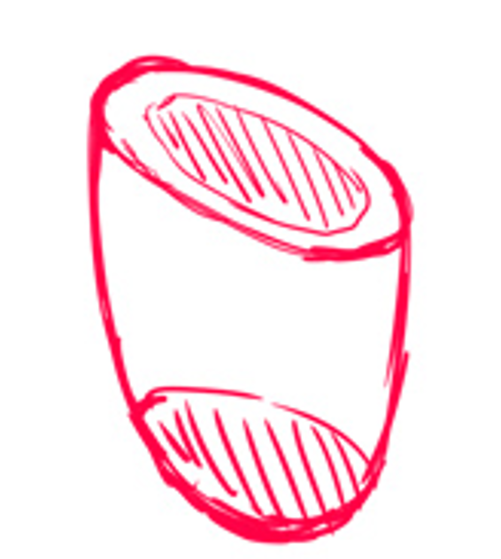

# 胸肌
- 从三角肌附近作连线，在腋下形成三角区域；这一整块就是胸肌
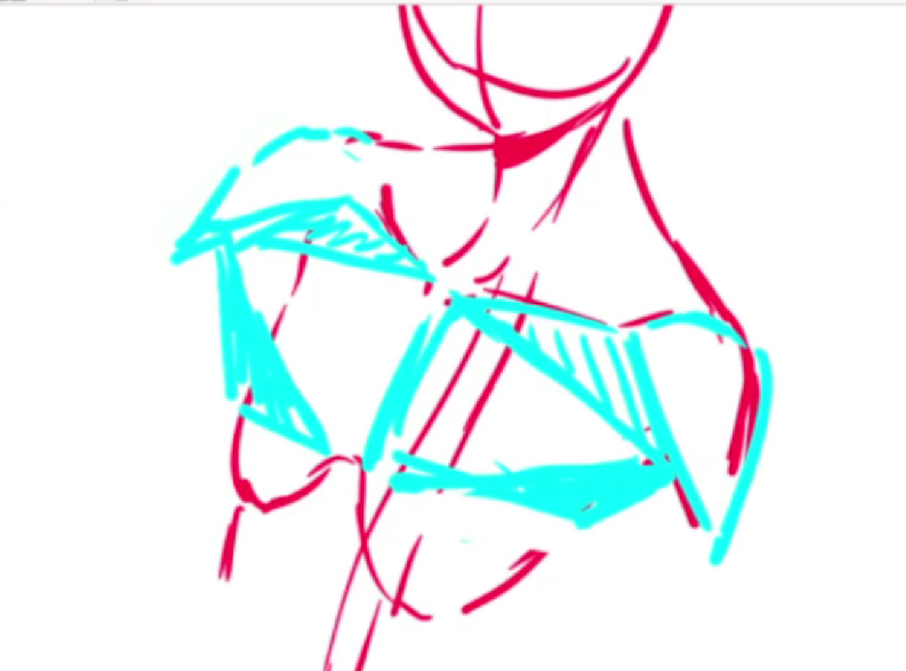

# 胸
- 胸的起点是从胸肌区域下来，并贴在胸肌上
- 胸更像水滴，或像装满水的塑料袋：上方固定，底部自然下垂，柔软地挂在胸腔上
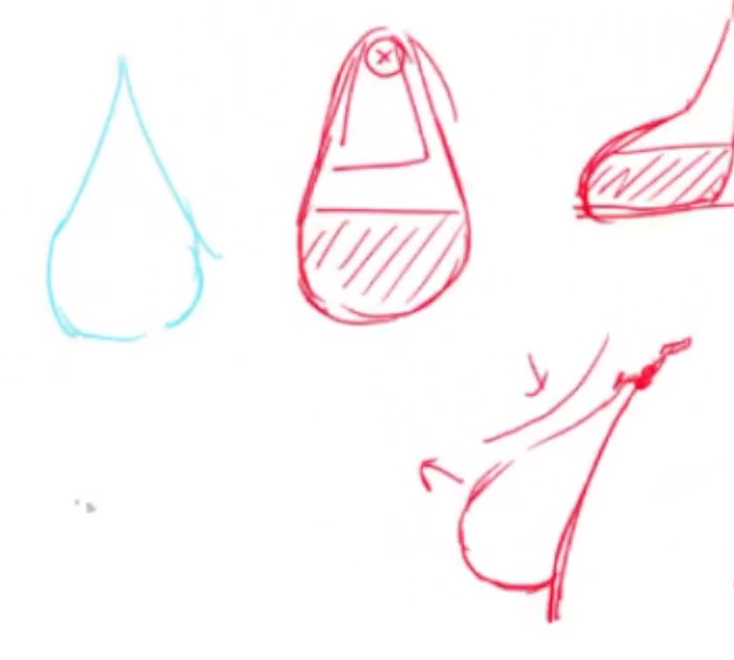

## 腰腹
- 相当于把切半的苹果贴在上半身与下半身交界处
- 二次元的腰更短、更细
- 需强调**腹外斜肌**和**盆骨骨点**等转折处，这些肌肉挤压的细节很出效果
- 照片参考被遮挡的部分，需要额外找参考补充
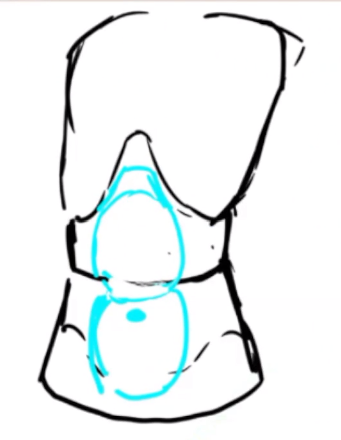

## 大臂
- **检查臂长**：将手肘按在小腹上，手肘位置应比肚脐略高
- 手画得比照片小，手掌约等于脸颊大小

# 三角肌
- 侧面看像三角形
- 立体看像一个较圆的盖子，也类似鼠标造型
- 锁骨末端卡死并连接着三角肌
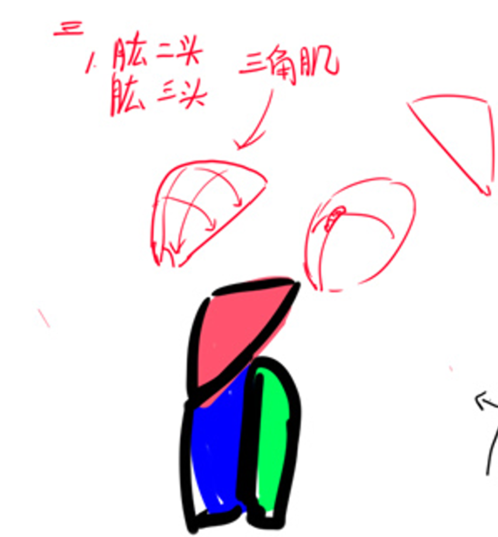

# 肱二头肌与肱三头肌
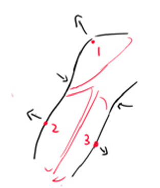
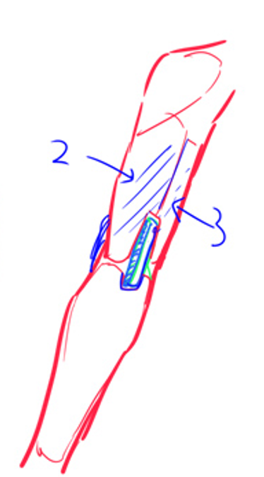

# 五官比例
- 偏好"**三庭三眼**"（而非三庭五眼），可用九宫格辅助定位
- **检查眼睛透视**：沿头部透视画三条弧线——眉弓到耳朵、眼角连线、眼睛底端连线，确保透视正确

## 腿部
- 二次元的腿更细、稍短
- 关键结构点：**缝匠肌**（在照片上明显）、**大转子**（下半身最宽处）

---

## 区分男女以及年龄

**男性**：眼睛靠上，脖子更粗，肌肉更明显，身体曲线弱化，眉毛更粗，肩宽比 1.5 头宽一些，眼睫毛弱化

**女性**：眼睛靠下，脖子细，肌肉不明显，腰部臀部有明显曲线，盆骨更大，眉毛纤细，肩宽在 1.5 头及以下，眼睫毛明显

---

## 五官定位与透视

### 眼睛

- 用四个折线代表睫毛，折线可暗示透视
- 用弧线标黑眼球位置，可适当扩大
- **透视纠正**：头部透视是"折叠"关系，而非简单的近大远小。离镜头远的眼睛是**变窄**（高度不变），而不是变小
