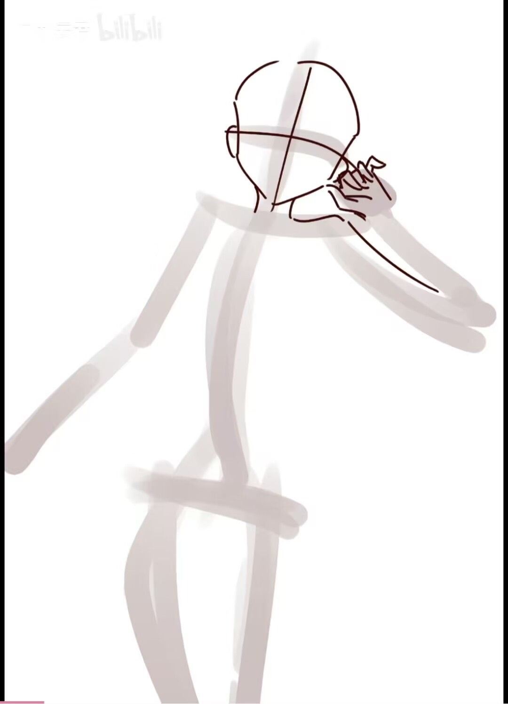
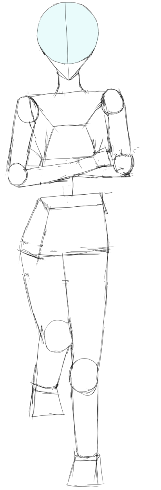
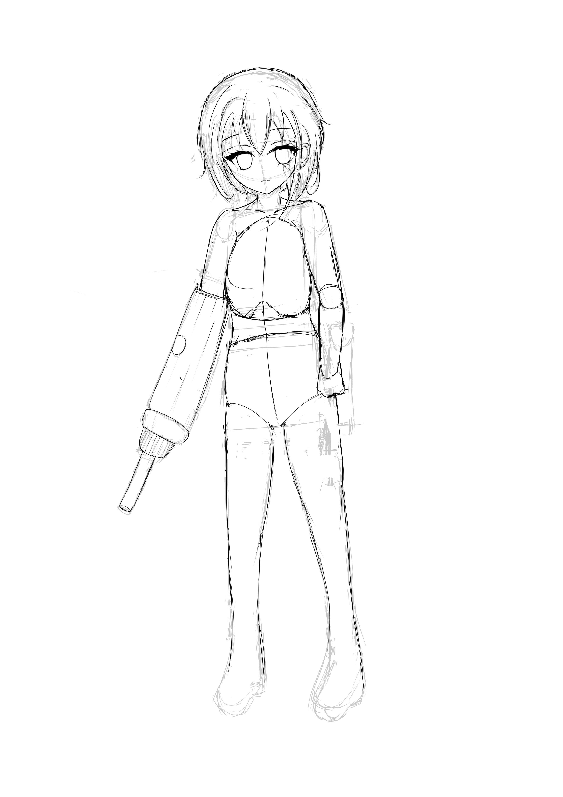

# 起草

## 插画

- **注意**：画的过程中多使用 `H` 键左右翻转，避免结构错误

### 用杂乱大胆的线条定好最初版的构图造型即可，甚至只需要到达示意图的精细级别

### 体块概括人物

- 头部用球和用三角连接的下巴概括
- 关节用球来概括
- 大臂小臂以及大腿小腿都使用圆柱来概括
- 胸腔使用长方体概括
- 盆骨处用棱台概括
- 脚

### 体块转换为大致的骨架和肌肉

- 关键点在于找好中线
- 背诵常见的骨骼肌肉

---

### 画透视线
